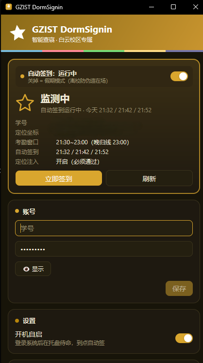
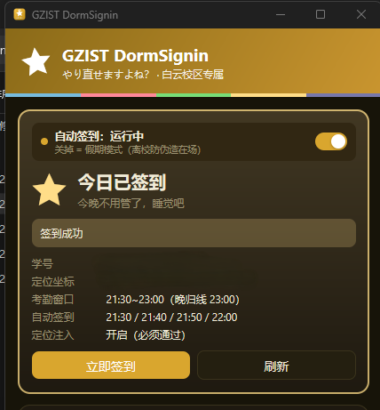

<div align="center">


# GZIST DormSignin

**广州理工学院智能查寝 · Windows 自动签到辅助客户端 · MyGO!!!!!**

[](LICENSE)
<br>


[](https://github.com/egoist/mygo)

**[快速上手](#-快速上手) · [日常使用](#-日常使用) · [常见问题](#-常见问题) · [免责声明](#%EF%B8%8F-免责声明请先读这一段)**

</div>

---

填入学号和密码后，程序常驻托盘，默认在 **每天 21:30 / 21:40 / 21:50 / 22:00 尝试宿舍查寝签到**。支持本地算式验证码识别、浏览器隐藏及任务间复用，保留 MyGO!!!!!／长崎爽世的金色主题。正常条件满足时自动完成；学校要求二次验证时，仍需本人处理。

> **二次验证问题尚未正式解决。** 近期两晚自动签到成功不代表永久免验证；学校仍可能再次要求手机等验证。请结合下方实测记录和免责声明使用。

<p align="center">
  
</p>
<p align="center"><sub>主窗口实机截图：托盘图标是<b>金黄色星星</b>，监测中会呼吸（亮 ⇄ 暗金），与校园网保活（蓝星）、有线转热点（绿星）并排也一眼分清。截图为<b>此前版本的白云校区实机展示</b>（当时考勤窗口 21:30~23:00），不代表所有校区均已验证；新版部分控件与图中可能不同。截图中学号、定位坐标等隐私信息已打码。</sub></p>

<p align="center">
  
</p>
<p align="center"><sub>签到成功示例：用户实机运行后显示「今日已签到 / 签到成功」，学号及定位坐标已遮挡。该截图展示一次成功签到结果，不单独证明定时自动触发已经验证。</sub></p>

> Go + [MyGo](https://github.com/egoist/mygo) 框架重写：核心思路全部来自 [skylinejoin/Gzist-bedcheak-huizhou-](https://github.com/skylinejoin/Gzist-bedcheak-huizhou-)（原惠州校区脚本版），由原 PowerShell 脚本移植为 Go，并持续补充回归测试；计划任务、wscript、vbs 全部退役，改为**常驻托盘 + 内置调度**。

## 🆕 2.0.20 更新与实测

[查看完整更新说明](docs/releases/v2.0.20.md) · [下载最新版本](https://github.com/xiaomai1011/GZIST-DormSignin-Baiyun/releases/latest)

本次主要完善登录状态判断、官方二次验证人工接续、常驻浏览器与受控标签页复用、隐藏状态下的输入，以及点击失败和清理异常处理。保留原有 MyGO!!!!! 外观与用户数据。业务页超时后的一次会话恢复在 v2.0.2 已经存在，不重复算作新增功能。

**两晚自动签到记录（北京时间）：**

- **2026-11-17**：21:30:29 定时启动，自动登录及业务页恢复后，21:33:00 开始点击，21:33:01 记录签到成功。
- **2026-11-18**：21:30:36 定时启动，21:30:59 自动登录成功；业务页恢复后，21:33:06 开始点击，21:33:08 记录签到成功。

用户确认没有手动签到，这两轮均未记录进入手机二次验证。完成任务的是当时安装的 2.0.20；日志记录了提交尝试及随后成功提示，未关联服务器审计请求 ID。

**可能与学校近期取消、放宽或暂时未触发二次验证有关，但这只是推测，尚无校方确认或同条件对照验证。** 我们没有正式解决二次验证，也不保证后续每天或所有账号都能无人值守。

期间我们也尝试过其他入口和登录态复用，但都还没有达成“长期免二次验证、稳定自动签到”的预期目标，未纳入本次发布。这些尝试不作为当前版本成功的依据。

## ⚠️ 免责声明（请先读这一段）

**本工具仅供学习与技术研究使用，且只允许用于「你本人的账号 + 你本人确实在宿舍」这一种场景。** 继续使用即表示你已阅读、理解并同意以下全部内容——这些边界继承自原作者，也是本项目存在的底线：

1. **它只是把你本来就要做、也完全合规的那次点击自动化**，省掉你掏手机的 30 秒。
2. **严禁用于以下用途**（原作者明确反对，且可能违反校纪校规甚至法律）：
   - 替**他人**签到、代签、批量签到；
   - 你**人不在宿舍 / 不在学校**时，用坐标注入伪造「在场」记录；
   - 绕过、对抗学校的考勤制度或信息系统安全机制。
3. **坐标注入不是「作弊工具」，而是「修 bug 的补丁」**。查寝页面依赖浏览器定位，而 Windows 定位服务经常失败（超时）或返回 IP 粗定位（可能偏出十几到上百公里），导致**人在宿舍也被判「不在考勤范围」**。本工具注入的是**你本人真实所在位置**的坐标，用来让页面恢复正确判断。**人不在那个位置时，必须打开假期模式或退出程序。**
4. **风险自负**。使用自动化可能违反学校的信息系统使用规定或考勤管理办法，可能导致**纪律处分、账号封禁、系统风控拦截**等后果。原作者与本仓库作者均不鼓励、不背书任何违规用法，**不对任何使用后果承担责任**。
5. **与学校无关**。本项目为非官方、非营利的个人技术实践，与任何学校、院系、厂商无关。
6. **不采集或回传个人运行数据**。账号密码用于学校正常认证，并保存在本机（优先使用 Windows 凭据管理器）；日志/截图只写在本机。更新检查访问官方 GitHub 版本信息，不上传账号、Cookie 或日志。**请务必不要把你的运行数据提交到公开仓库**（`.gitignore` 已排除）。
7. **如学校、系统管理员或原作者要求，请立即停止使用并删除本项目。**

## ✅ 适合谁用

- **广州理工学院白云校区**在校生（查寝页 `xsfw.gzist.edu.cn`，考勤 21:30~23:00）
- 电脑晚上开机联网；正常流程可在后台运行，遇到二次验证时需要本人处理
- 想省掉每晚掏手机点签到的 30 秒

**未经验证**：其他校区的入口、坐标与时段，请先核实，不保证直接适用。**不适用**：人不在宿舍时（见免责声明第 2、3 条——**必须停用**）。

## 📦 安装

从 [Releases 页面](https://github.com/xiaomai1011/GZIST-DormSignin-Baiyun/releases/latest) 下载 Windows x64 版本，无需登录 GitHub：

| 文件 | 怎么用 |
|---|---|
| `GZIST-DormSignin-v2.0.20.exe` | 绿色单文件，任意目录双击即用 |
| `GZIST-DormSignin-v2.0.20-windows-x64-setup.exe` | 安装器，自动建开始菜单快捷方式 |
| `SHA256SUMS` | 下载文件的 SHA-256 校验值 |

通常**不需要管理员权限**。当前构建没有代码签名证书；如 Windows 提示，请先确认下载来自本仓库的正式 Release，并核对 SHA256SUMS，再决定是否运行。

## 🚀 快速上手

1. **打开 GZIST DormSignin**，第一次运行自动弹出主窗口。
2. 在 **账号** 卡片填写 **学号** 和 **学工系统密码**，点 **保存**（存入 Windows 凭据管理器，不进命令行；框内始终回显，**清空后保存 = 删除账号**）。
3. 确认顶部 **「自动签到：运行中」** 开关已开启，按需要打开 **开机自启**。到配置时段会发起任务并加入随机延迟；请留意失败或人工验证提示。
4. 遇到学校二次验证时，在对应官方窗口中完成；常驻模式进入人工验证阶段会显示该账号的窗口，也可主动点击 **显示验证窗口**。同一账号不要同时运行多套签到程序。

## 🌟 日常使用

### 看托盘图标就够了

| 图标 | 含义 |
|---|---|
| ★ 金星**呼吸**（亮 ⇄ 暗金，1.5s） | **监测中** —— 程序活着，到点自动签（99% 时间的状态） |
| ★ 实心金星（稳定亮） | 今日已签到 |
| 星里有圆点 | 签到进行中 |
| 星里有「!」 | 需要你处理，打开主窗口看日志 |
| ☆ 灰色空心星 | 假期模式 / 未配置账号（程序没在守） |

### 它每晚做了什么

1. **时间守卫**：过了晚归线（23:00）直接放弃——**宁可漏签，绝不留晚归记录**；不在考勤时段同样放弃
2. **启动或复用 Edge**：按配置选择独立或常驻浏览器，按账号隔离配置目录；常驻任务复用受控标签页。Windows 通过 Job Object 管理本程序浏览器进程树；需人工验证时显示对应窗口
3. **定位处理**：按配置在页面加载前经 CDP 注入坐标，修复本人确实在宿舍时的 Windows 定位问题；不得用于伪造在场，见上方警告
4. **登录态判定**：观察 CAS 跳转；需要登录时使用本地保存的账号及算式验证码识别。明确验证码错误才按上限换图重试，不确定结果停止；学校二次验证由本人完成，程序不代发短信
5. **安全闸门**：页面必须显示可签状态（含「点击签到」、无「不在考勤范围」/「非考勤时段」/已签到），任一不通过就放弃
6. **可信点击**：CDP 鼠标事件点击「点击签到」→ 处理确认弹窗 → 检测「签到成功」→ 截图存证

### 主窗口

| 区域 | 作用 |
|---|---|
| **状态卡** | **「自动签到：运行中 / 已停用」开关**（关掉 = 假期模式）+ 状态大字 + 学号/坐标/考勤窗口/触发时间明细 + **立即签到** 按钮 |
| **账号** | 修改学号密码（框内始终回显；**清空后保存 = 删除账号**）＋ **验证登录**：只验证当前输入能否登录学工系统，不签到、不定位、不自动保存 |
| **设置 · 开机自启** | 登录系统后在托盘待命 |
| **常驻浏览器／显示验证窗口／隐藏浏览器** | 按账号复用浏览器并控制对应窗口；常驻不等于永久免认证 |
| **程序更新** | 检查官方正式版本并打开下载页，不自动替换运行中的程序 |
| **日志（爽世的记事本）** | 每一步的进度与结果；**日志文件** 打开完整日志 |

### 「验证登录」的结果怎么读

点 **验证登录** 会用当前输入真实提交一次登录（**只提交一次，不重试**），结果分四种显示：

| 显示 | 含义 |
|---|---|
| **✓ 绿色框**（账号密码验证通过） | 学校统一认证签发了新票据——当前账号密码可用。**只代表能登录，不代表已签到**，也不会自动保存 |
| **ⓘ 蓝色信息框** | **没取得可信的「通过」证据，也不是密码错误的判定**：可能是未识别的业务码、响应读取失败、超时，或网络/浏览器连接失败；也可能是学校页面只说了「登录失败」而没给原因。按提示稍后再试，或直接到学校官方登录页确认 |
| **顶部红条** | 学校**明确**拒绝：账号或密码错误，或账号被锁定／停用（页面提示「密码已连续错误 N 次」也算） |
| 普通文字 | 进行中、已取消、输入已修改（旧结果作废） |

> 蓝色框是**保守兜底**：宁可说「暂时无法确认」，也不把没见过的情况判成密码错误。**只有红条才代表学校明确否定了这次登录。**

### 与脚本版的差异

| | 脚本版（原作者） | Go 版（本工具） |
|---|---|---|
| 调度 | Windows 计划任务 + wscript + vbs | 常驻托盘内置调度（关程序=停签到） |
| 账密 | Edge 自动填充（不落盘） | Windows 凭据管理器（可回退 0600 文件） |
| 验证码 | GDI 模板匹配 | 同算法 Go 移植（840 模板） |
| 浏览器窗口 | 支持可见窗口等模式 | 支持独立／常驻及对应窗口显隐，遇二次验证需本人完成 |

## ❓ 常见问题

<details>
<summary><b>「需要人工登录」/ 自动登录没成功</b></summary>

先在 **账号** 卡片确认学号密码已保存。若学工系统改过密码，更新后再操作。若页面要求手机／其他二次验证，请在官方窗口内完成；不要把需要人工验证等同于密码错误。连续失败或结果不明时先看日志，不反复点击。
</details>

<details>
<summary><b>点了「验证登录」显示蓝色框 / 「暂时无法确认」</b></summary>

蓝色框表示**这次没拿到可信的「登录通过」证据，也没有可信的失败原因**——**它不是「密码错误」**。常见来源：学校返回了本工具尚未识别的业务码、认证响应没读到或读超时、网络／浏览器连接失败，或学校页面只提示「登录失败」却没给具体原因。可以稍后再点一次（**别连点**）；若反复如此，直接到学校官方登录页用同一套账号密码试一次最可靠。
</details>

<details>
<summary><b>页面显示「不在考勤范围」</b></summary>

定位校验没通过，程序会拒绝点击（宁可不签不误点）。确认你本人确实在宿舍范围内；若一直在宿舍仍报错，检查注入坐标是否被改动（settings.json 的 `lat` / `lon`）。
</details>

<details>
<summary><b>错过了 21:32 会不会漏签</b></summary>

默认还有 21:40 / 21:50 / 22:00 三个槽位，任一成功即停；但电脑休眠、断网、程序退出或未完成人工验证仍可能漏签。单次晚于 23:00（晚归线）则放弃。白天手动点「立即签到」提示「不在考勤时段」属正常。
</details>

<details>
<summary><b>假期回家怎么办</b></summary>

打开 **假期模式**（状态卡顶部的开关关掉即可）。人在外面时程序不发起任何签到——**绝不能人在校外却注入宿舍坐标**，那是伪造在场。回校后重新打开。
</details>

<details>
<summary><b>密码存在哪里，安全吗？</b></summary>

优先使用 **Windows 凭据管理器**；凭据服务不可用时回退到数据目录文件，界面会提示。回退文件不应等同于系统凭据库加密，请保护本机账户和文件访问权限。密码不进命令行，仅用于学校认证；勿将凭据、浏览器数据或日志公开。
</details>

<details>
<summary><b>从脚本版升级</b></summary>

把旧文件夹里的 `config.json` 放到新 exe 旁边，首次启动**自动导入**坐标等配置（账号密码需重新填一次——旧版存在 Edge 里，新版改为凭据管理器）。
</details>

## 🗑️ 卸载

托盘右键 **退出**，然后：绿色版直接删 exe；安装版走「设置 → 应用」。数据目录 `C:\Users\<你>\AppData\Roaming\GZIST DormSignin\` 与凭据管理器中的「GZIST」条目一并删除即彻底清除。

## 🛠️ 开发者

<details>
<summary>展开</summary>

Go 1.27 + [MyGo](https://github.com/egoist/mygo) 原生 UI（GPU 自绘，无 webview / Node）；CDP 用 [chromedp](https://github.com/chromedp/chromedp)（纯 Go，无 cgo）。

```sh
go vet ./... && go test ./...    # 静态检查 + 测试（模板构建/自洽识别/缓存往返）
go tool mygo build               # 打包（输出 build/）
go run ./tools/genicon           # 重新生成 resources/icon.png
GZIST DormSignin.exe -selftest   # 只读自检：配置/凭据/Edge/验证码模板
```

| 路径 | 内容 |
|---|---|
| `main.go` | 装配：托盘（呼吸）、窗口、调度循环、legacy 导入、`-selftest` |
| `view.go` | 主窗口（Soyo 金黄主题） |
| `internal/signin` | 签到状态机：时间守卫、登录、闸门、点击、成功检测 |
| `internal/edge` | Edge 启动、受控目标页附加与 CDP 会话 |
| `internal/browserhost` | 常驻宿主、账号隔离、租约及窗口管理 |
| `internal/updatecheck` | 官方正式版本检查 |
| `internal/captcha` | 算式验证码识别（模板构建/匹配/缓存） |
| `internal/store` | 设置 + 凭据管理器 + 旧配置导入 |
| `internal/art` | 程序绘制的图标（金黄星四态+呼吸、AppIcon） |

**验证登录的诊断**（`DORMSIGN_VERIFY_DIAG=0` 可关，默认开）：每次「验证登录」在日志里写**一行**脱敏摘要，只含固定枚举、有界数字和请求 id 的 8 位哈希——不含账号、密码、Cookie、票据、完整 URL、响应体或页面文字：

```
验证诊断: stage=… failed_stage=… reason=… error_class=… cleanup=… release=… shutdown=… leftover=… code=… http=… bytes=… trusted=… cached=… req=… prompt=… elapsed=…s
```

`prompt=` 是**页面提示辅助观察**的结果（只对「未识别业务码」响应生效，最多看 2 秒登录页自带的固定错误区域，且必须是本次提交后新出现的提示）：`snapshot_failed`＝提交前快照没取到、页面路径整轮禁用 / `no_new_sentence`＝没看到可用提示 / `credential`·`locked`·`captcha`·`password_counter`·`password_lock`＝页面确认了具体原因 / `generic`＝页面只说「没通过」（保持蓝色未知）/ `interrupted`＝被取消或超时打断。

**发布**：改 `mygo.json` 版本与发布说明 → 测试并提交源码 → `go tool mygo build -o <隔离输出目录>` → 核验版本与 `vcs.modified=false` → 原子推送 main 和 annotated tag → 创建草稿并上传 EXE、Setup 与 SHA-256 → 核验资产后公开。
</details>

## 🙏 声明与致谢

- **原始作者与全部核心思路**：[skylinejoin/Gzist-bedcheak-huizhou-](https://github.com/skylinejoin/Gzist-bedcheak-huizhou-)（广州理工学院查寝自动签到 · 惠州校区脚本版）——无窗口 Edge + CDP、验证码本地识别、定位注入、安全闸门，均出自原作者的设计；验证码识别算法逐行移植自他的 `captcha-solve.ps1`。谨致谢意。
- 本仓库最初为**白云校区适配** + Go/MyGo 框架重写：原默认坐标与考勤时段来自白云校区（21:30~23:00），不代表所有校区均已验证；架构与 UI 对齐 [xiaomai1011/GZIST-NetKeeper](https://github.com/xiaomai1011/GZIST-NetKeeper)（蓝星）与 [xiaomai1011/GZIST-Hotspot](https://github.com/xiaomai1011/GZIST-Hotspot)（绿星）——本工具为**金星**。
- 请遵守学校网络与考勤管理规定。

## License

[MIT](LICENSE)（版权行：skylinejoin 原项目 + xiaomai1011 重写）
